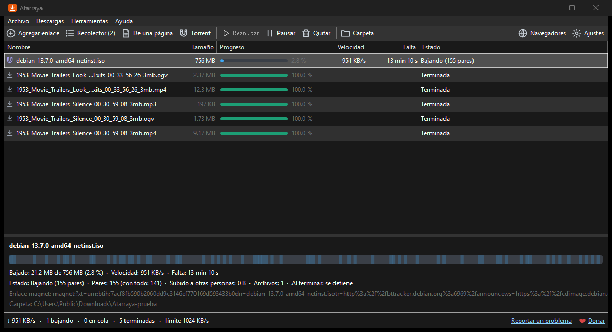

# Atarraya

**Descargas, videos, torrents y enlaces magnet en un solo programa, gratis para Windows.** Baja cada archivo en
varias partes a la vez, se puede pausar y seguir después (aunque apagues la PC) y recibe las descargas y los videos
de tu navegador, como IDM. Junta muchos enlaces en un recolector, como JDownloader, y te deja elegir qué bajar. Sin
publicidad, sin virus y sin recoger tus datos.

Hecho por [Brizna Soft](https://brizna-soft.github.io) en Honduras.



## Descargar

**[Baja la última versión](https://github.com/Brizna-Soft/atarraya/releases/latest)**: el archivo
`Atarraya-x.y.z-x64.zip`.

1. Descomprime el .zip en una carpeta, por ejemplo `Documentos\Atarraya`.
2. Abre `Atarraya.exe`. No hace falta instalar nada.

> **¿Windows dice «Windows protegió su PC»?** Sale porque el programa es nuevo y todavía no tiene firma
> digital, que cuesta dinero. Pulsa **Más información** y luego **Ejecutar de todas formas**.
>
> Si quieres comprobar que el archivo es el original, compara su huella SHA-256 con el archivo `.sha256` de la
> misma página. Los .zip los arma GitHub a partir de este mismo código.

## Qué hace

- **Varias conexiones por archivo.** Hasta 16, y 8 de fábrica. Cuando una parte termina, ayuda a la que más le
  falta, así ninguna conexión se queda sin trabajo.
- **Torrents y enlaces magnet.** Eliges qué archivos bajar, ves el progreso, la velocidad y cuántas personas lo
  comparten, pausas y sigues cuando quieras. Al terminar se detiene, salvo que marques «Seguir compartiendo».
- **Recolector de enlaces.** Pega muchos enlaces de una vez (o abre un .txt) y Atarraya te muestra el nombre y el
  tamaño de cada uno sin bajarlo, agrupados en paquetes («peli.part1.rar», «peli.part2.rar»... van juntos).
  También toma los enlaces de archivos que copies, si dejas encendido «Vigilar el portapapeles». **Nada empieza
  hasta que lo confirmas.**
- **Click'n'Load.** Sitios como filecrypt.cc pueden pasarle a Atarraya los enlaces de una carpeta, igual que a
  JDownloader, después de que tú resuelves el captcha en tu navegador. Llegan al recolector y tú decides. Desde la
  0.3.1 entiende más formas de mandarlos: formularios de cualquier tipo (también «multipart»), los campos `urls`,
  `url`, `links` o `link`, enlaces separados por saltos de línea, espacios o comas, y `GET /flash/add?urls=...`. Si
  un sitio te muestra la respuesta en la pestaña, la ves en español; si algo no llega, el registro dice por qué.
- **Sitios de descargas gratis, de una en una.** Las partes de un paquete (Rapidgator, ddownload, katfile,
  nitroflare, 1fichier...) se abren en tu navegador de a una: tú resuelves el captcha y Atarraya hace lo demás.
  Desde la 0.4.0 no pierde la descarga aunque el sitio no deje que otro programa la baje (la sigue en el
  navegador), y si el sitio pide esperar («Blocked: wait 10 minutes»), cuenta el tiempo, abre la página otra vez y
  te avisa. Ver [Sitios de descargas y captchas](#sitios-de-descargas-y-captchas).
- **Descomprime con Jícaro.** Si tienes [Jícaro](https://brizna-soft.github.io/programas/jicaro/), el descompresor
  gratis de Brizna Soft, cuando terminan de bajar todas las partes de un paquete Atarraya lo descomprime solo, en una
  carpeta con su nombre. Ver [Descomprimir con Jícaro](#descomprimir-con-jícaro).
- **Los archivos de una página.** Pega la dirección de una página y Atarraya te muestra los archivos que enlaza
  (videos, música, documentos, programas...) para que marques cuáles bajar. En Internet Archive usa su lista
  oficial de archivos.
- **Los videos de las páginas, como IDM.** Pon el ratón sobre un video y pulsa **Descargar este video**, o abre la
  ventanita de la extensión para ver todos los videos de la pestaña. Baja archivos MP4 y WebM y transmisiones HLS y
  DASH. Nada se baja solo. **No baja videos de YouTube ni videos protegidos con DRM.** Ver
  [Videos de las páginas](#videos-de-las-páginas).
- **Pausar y seguir.** También después de cerrar el programa o de apagar la PC, si el servidor lo permite.
- **Cola de descargas.** Elige cuántas bajan a la vez (los torrents también cuentan); las demás esperan su turno.
- **Reintenta solo** cuando se cae el internet.
- **Límite de velocidad**, para no dejar sin internet al resto de la casa. También uno de subida para los torrents.
- **Cambiar el enlace.** Si un enlace vence, pegas uno nuevo del mismo archivo y sigue donde quedó.
- **Huella SHA-256**, para comprobar que el archivo llegó entero.
- **Cuida tu seguridad.** Marca lo bajado como «descargado de internet», igual que los navegadores, para que
  Windows y tu antivirus lo revisen antes de abrirlo.
- **Queda junto al reloj** mientras baja, y te avisa cuando termina.

## Sitios de descargas y captchas

Atarraya no se salta ni acorta las esperas, los límites ni los captchas de los sitios de descargas (Rapidgator,
1fichier, ddownload, katfile, nitroflare, Mega y otros), ni los resuelve solo: **los captchas siempre los resuelves
tú en tu navegador.** No hace clics en la página, no cambia tu IP ni usa proxys para saltarse un límite, y no usa
cuentas premium. No abre contenedores DLC.

**De una en una.** Cuando en el recolector marcas páginas de esos sitios (por ejemplo, las 18 partes de una
película) y pulsas «Descargar los marcados», Atarraya no las abre todas a la vez:

1. Abre la primera en tu navegador. Arriba de la lista, Atarraya te dice «Parte 1 de 18 en tu navegador:
   resuelve el captcha y pulsa descargar».
2. Tú resuelves el captcha y pulsas descargar en la página. La extensión le pasa la descarga a Atarraya, que la
   toma sola si es seguro que es esa parte: si tiene el nombre del archivo y viene de ese sitio, o si sale de la
   misma página que abrió. Si viene de ese sitio pero hay duda, te pregunta. Lo demás sigue como cualquier
   descarga.
3. Cuando termina, Atarraya abre la página siguiente y te avisa junto al reloj.

Los botones «Abrir la siguiente ahora», «Saltar esta» y «Parar» te dejan ir a tu ritmo; lo que saltas o paras
vuelve al recolector para otra vez. Si cierras Atarraya, al abrirlo sigue donde iba. Atarraya no toca la
página: solo la abre y recibe lo que el navegador le pasa. Baja cada parte con una sola conexión, como el
navegador. Necesita la extensión conectada (ver abajo); si no lo está, te avisa.

Lo mismo pasa si pegas uno de esos enlaces en **Agregar enlace** o lo eliges en **De una página**: se abre en tu
navegador de una en una, en vez de bajar la página. También van de una en una las páginas que llegan por
Click'n'Load y las que se llaman como un archivo (`.../peli.part1.rar`), aunque Atarraya no conozca el sitio. Y si
algún sitio responde con una página en vez del archivo
(por ejemplo, porque pide un captcha o porque el enlace venció), Atarraya no la guarda como si fuera el archivo:
te avisa «El sitio respondió con una página, no con el archivo» y te ofrece **Abrir en el navegador**.

**Desde la 0.4.0, Atarraya nunca pierde tu captcha.** Cuando pulsas descargar en una página de la cola, el
navegador empieza a bajar y Atarraya prueba seguir esa descarga con una conexión (con las cookies y la página de
origen). Si el sitio lo deja, la del navegador se cancela y la baja Atarraya. Si no lo deja (responde con una
página, con un error 403 o 410, o el enlace es de un solo uso), la termina el navegador y la extensión la sigue
hasta el final: cuando termina, Atarraya pasa el archivo a la carpeta del paquete, lo anota en la lista y abre la
página siguiente. Atarraya recuerda esos sitios: la próxima vez deja la descarga en el navegador desde el principio.
También funciona cuando la descarga sale de un formulario (los sitios que bajan después de pulsar un botón).

**Esperas.** Mientras Atarraya está abierto, le pide a la extensión que abra cada página de la cola. En esas pestañas
(y solo en esas: nunca en una que abriste tú), la extensión lee el texto que se ve y reconoce los avisos de espera: «You have to wait 9 minutes till next download», «Blocked: wait 10 minutes», «Download limit
reached», «Debes esperar 5 minutos», «Vous devez attendre 15 minutes», relojes de cuenta regresiva... Atarraya te
muestra la cuenta regresiva arriba de la lista y:

- si el sitio pide esperar entre descargas, cuando se cumple el tiempo (más un margen) abre la página otra vez y te
  avisa con un sonido y «Toca resolver un captcha». Si la página todavía pide esperar, vuelve a intentar más tarde,
  hasta 6 veces; después la deja para el final (vuelve al recolector);
- si es la cuenta regresiva de la página, te avisa cuando termina.

Si la extensión no está conectada, Atarraya abre la página en tu navegador como antes, pero ahí no se leen los
avisos de espera.

**Nunca bajan dos veces la misma parte.** Mientras Atarraya prueba seguir la descarga del navegador, lo anota en la
cola: si se cierra a la mitad, al volver a abrirlo queda la del navegador y quita la suya. Si no se puede confirmar
que el navegador dejó de bajarla, Atarraya pausa la suya, te avisa y no sigue hasta saberlo. Si el navegador termina
una parte con Atarraya cerrado, la extensión guarda el aviso y se lo pasa cuando vuelve a abrirse: la parte se pasa a
la carpeta del paquete y sigue hasta Jícaro. Antes de mover lo que bajó el navegador, Atarraya revisa que sea el
mismo archivo, sin enlaces en ninguna carpeta, y lo mueve sin pisar nada.

**Aunque Atarraya se cierre de golpe en cualquier momento**, la cola y la lista de descargas se guardan juntas, en un
solo archivo y de una vez, así que nunca queda una sin la otra. Al abrirlo, y cada vez que la extensión se conecta y
cuenta qué descargas del navegador conoce, Atarraya junta todo parte por parte: si quedaron dos descargas de la misma
parte, deja una sola, y si una parte se quedó sin ninguna, vuelve a la cola para abrirse otra vez. Si al cerrarse ya
había tomado una parte, espera a que tu navegador diga si siguió con la suya antes de seguir con la propia (si en un
minuto no dice nada, sigue la de Atarraya).

Cuando terminan todas las partes de un paquete, también las que bajó el navegador, Jícaro las descomprime como
siempre (ver abajo). La extensión no pide permisos nuevos.

## Descomprimir con Jícaro

Desde la 0.2.2, si tienes [Jícaro](https://brizna-soft.github.io/programas/jicaro/), el descompresor gratis de
Brizna Soft, Atarraya le pide que descomprima lo que bajaste en cuanto termina:

- **Cuándo:** cuando terminan todas las partes de un paquete (de «de una en una», del recolector o de **De una
  página**) o un .rar, .zip o .7z suelto. Si una parte falla o todavía no se baja, espera; también a una que ya se
  estaba bajando cuando llegó el paquete. Las partes que bajas sueltas desde el navegador no se descomprimen solas,
  porque Atarraya no sabe si ya están todas.
- **Dónde:** en una carpeta nueva con el nombre del paquete, al lado de las partes. Si ya existe, usa «nombre (2)».
- **Qué te dice:** arriba de la lista ves cómo terminó: listo, faltan partes, tiene contraseña, cancelado o no se
  pudo. Jícaro muestra los detalles en su propia ventana.
- **Las partes no se borran solas.** Cuando Jícaro termina bien, Atarraya te ofrece **Borrar las partes**: van a la
  Papelera, y solo si lo pulsas. Solo manda las de ese paquete que siguen siendo los mismos archivos que bajó; si
  alguna cambió o la reemplazaron, la deja donde está y te avisa.

Atarraya busca Jícaro en `%LOCALAPPDATA%\Programs\Jicaro`. Si lo tienes en otra carpeta, elígelo en **Ajustes** con
**Elegir...**; ahí también se apaga, con la casilla **Descomprimir con Jícaro al terminar**. Si no encuentra Jícaro,
no hace nada y en Ajustes te ofrece abrir su página. Solo le pasa a Jícaro archivos que bajó él mismo, con la ruta
revisada y entre comillas, y lo abre sin quitarle el foco a lo que estés haciendo.

## Conectar con el navegador

Atarraya toma las descargas de **cualquier sitio**, igual que IDM. Las únicas que se quedan en el navegador son
las que salen de un formulario, las que arma la misma página y los videos de YouTube.

1. En Atarraya pulsa **Navegadores** → **Conectar**. Esto solo le avisa a tu navegador dónde está Atarraya,
   dentro de tu cuenta de Windows, y se puede quitar con **Quitar la conexión**.
2. Instala la extensión. Mientras llega a las tiendas, se carga a mano:
   - **Chrome, Edge o Brave:**
     1. Abre `chrome://extensions` (en Edge, `edge://extensions`).
     2. Activa el **Modo de desarrollador**.
     3. Pulsa **Cargar descomprimida** y elige la carpeta `extension\chrome` que viene dentro del .zip.
   - **Firefox:** la extensión necesita la firma de Mozilla, que todavía no tiene (la carpeta
     `extension\firefox` ya está lista para enviarla). Mientras tanto, pega los enlaces en Atarraya con
     **Agregar enlace**.
3. Listo. Lo que bajes en el navegador se pasa a Atarraya. También puedes hacer clic derecho en un enlace (o en un
   enlace magnet) y elegir **Descargar con Atarraya**.

Si Atarraya está cerrado, se abre solo junto al reloj. Si no está conectado, el navegador baja todo como siempre.

**Al pasar a una versión nueva, recarga la extensión.** En `chrome://extensions` (en Edge, `edge://extensions`)
busca Atarraya y pulsa el botón de recargar (la flecha en círculo). Si pusiste la versión nueva en otra carpeta,
quita la extensión, vuelve a pulsar **Cargar descomprimida** con la carpeta `extension\chrome` nueva y, en
Atarraya, pulsa otra vez **Navegadores** → **Conectar**. La 0.4.0 lo necesita: su extensión sigue las descargas
de los sitios de descargas y lee sus avisos de espera (la 0.3.0 trajo el botón **Descargar este video** y la lista
de videos de cada pestaña).

Si te olvidas, a veces el navegador sigue con la parte de fondo vieja de la extensión. Desde la 0.4.0, al abrir la
ventanita de Atarraya (su ícono, arriba a la derecha) la extensión lo nota y se recarga sola. Si sigue igual, la
ventanita muestra el botón **Recargar la extensión** y los pasos para quitarla y volver a cargarla. El botón
**Descargar este video** también te avisa.

### Los permisos de la extensión

La extensión pide solo lo que usa, y nada de lo que ve sale de tu PC:

- **Descargas** (`downloads`): para pasarle a Atarraya lo que bajas en el navegador y, en «de una en una», para
  seguir hasta el final una descarga que el sitio solo deja bajar al navegador (cuánto va y dónde quedó).
- **Comunicación con programas** (`nativeMessaging`): para hablar con Atarraya, que está en tu misma PC. No habla
  con ningún servidor. Mientras Atarraya está abierto, la conexión queda abierta para que te abra las páginas de «de
  una en una»; si lo cierras, se cierra sola.
- **Menú del clic derecho** (`contextMenus`): para **Descargar con Atarraya**.
- **Cookies** (`cookies`): para que Atarraya pueda bajar lo que pide haber iniciado sesión. Solo lee las del sitio
  de esa descarga (para un video, las del marco donde está), y solo cuando empieza una descarga o pulsas un botón.
- **Almacenamiento** (`storage`): para tus ajustes de la extensión; mientras el navegador está abierto, la lista de
  videos de cada pestaña y qué pestañas son de la cola de «de una en una» (se borran al cerrarlo); y las descargas
  de la cola que está siguiendo, solo hasta que Atarraya sabe que terminaron.
- **Ver los pedidos de las páginas** (`webRequest`): solo mira las respuestas, sin bloquearlas ni cambiarlas, para
  saber en qué pestaña nació una descarga y qué videos, listas HLS o manifiestos DASH pidió el reproductor.
- **Todos los sitios** (`<all_urls>` y el botón en las páginas): porque las descargas y los videos pueden venir de
  cualquier sitio, también de un marco de otro sitio. El botón no se carga en YouTube ni en sitios con DRM. Los
  avisos de espera solo se leen en las pestañas que la misma extensión abrió para la cola de «de una en una»,
  cuando Atarraya se lo pidió.

## Videos de las páginas

Desde la 0.3.0, la extensión encuentra los videos de la página que estás viendo, como IDM:

- **El botón «Descargar este video»** aparece arriba a la derecha del video cuando pones el ratón encima, para no
  tapar los controles del reproductor. También dentro de un reproductor que está en un marco de otro sitio.
- **La ventanita de la extensión** (su ícono junto a la barra de direcciones) muestra los videos de la pestaña y de
  todos sus marcos, con su nombre y, si se sabe, su calidad o su tamaño, y un botón **Bajar** para cada uno.
- **Nada se baja solo.** La extensión solo mira lo que el navegador ya pidió para reproducir el video, y nada sale
  de ella hasta que pulsas un botón. Entonces se lo pasa a Atarraya como cualquier descarga, con las cookies y la
  página del marco donde está el video.
- **Sitios que no dicen cuál es la lista del video** (LinkedIn, por ejemplo, la pide sin `.m3u8` en la dirección):
  cuando pulsas el botón, la extensión vuelve a pedir el principio de lo que el reproductor de ese video ya pidió, y
  nada más: ni lo que diga una lista ni otro servidor, y no sigue redirecciones. Si en la página hay varios videos,
  elige la lista que dura lo mismo que el video que pulsaste; si no puede comprobarlo, no manda ninguna.
- **Si no se puede, el botón dice por qué:** que todavía no encontró el video (dale play), que no encontró su archivo
  completo, que no encontró cuál de los videos de la página es, que la extensión se reinició (recarga la página) o que
  no pudo hablar con Atarraya.

Qué hace Atarraya con cada uno:

- **Un archivo MP4 o WebM:** una descarga normal, con varias conexiones.
- **HLS (.m3u8):** si la lista trae varias calidades, eliges cuál (la mejor ya viene marcada). Baja las partes con
  tus conexiones y tu límite de velocidad, y las junta en un solo archivo `.ts` (o `.mp4` si la lista es CMAF), que
  abre cualquier reproductor, como VLC.
- **DASH (.mpd):** baja el mejor video y el mejor audio (o los que elijas), cada uno en su archivo: «(video)» y
  «(audio)». **No los une**: para juntarlos hace falta un programa aparte, como FFmpeg, que Atarraya no trae.
- **Antes de bajar nada**, Atarraya lee todas las listas que va a usar (la de la calidad, la del audio y las de los
  subtítulos) y revisa todas sus partes. Si el video está en tu red (esta PC u otro aparato de tu casa), te pregunta
  antes de bajarlo; una lista de internet nunca puede hacer que Atarraya se conecte a tu red. Por eso los videos de las
  páginas (y las consultas del recolector) no usan el proxy de Windows: van directo, y así Atarraya ve a dónde se
  conecta de verdad. Las demás descargas sí lo usan.
- **Si el programa se cierra de golpe**, al abrirlo sigue desde la última parte que quedó entera.

Lo que no baja:

- **Nada de YouTube**: ni botón ni lista en youtube.com, youtu.be, youtube-nocookie.com ni m.youtube.com, ni nada
  que venga de googlevideo.com, aunque llegue por una redirección o esté en un marco de otra página. Sus
  condiciones no lo permiten.
- **Nada protegido ni cifrado.** Si el video usa DRM (en el navegador, EME), si alguna de sus listas HLS (también la
  del audio o la de los subtítulos) trae una clave (`EXT-X-KEY`, con cualquier método) o si el manifiesto DASH dice
  `ContentProtection`, te dice **Este video está protegido** y no baja nada. Tampoco en Netflix, Disney+, Prime
  Video, Max y sitios parecidos.
- Transmisiones en vivo, videos DASH partidos en varios períodos y listas enormes (más de 150.000 partes o de 16 MB):
  te avisa que no se pueden y no baja nada (nunca un video a medias).
- Como siempre: no se salta esperas ni captchas, y una lista de internet no puede hacer que Atarraya se conecte a
  tu PC ni a tu red local.

## Torrents

- Mientras un torrent baja, Atarraya también sube partes a otras personas: así funcionan los torrents. Las otras
  personas del torrent ven tu dirección de internet (IP), como en cualquier programa de torrents. Baja solo lo que
  tengas derecho a compartir.
- La primera vez que bajes un torrent, Windows puede preguntar si Atarraya puede recibir conexiones. Si pulsas
  **Cancelar**, igual baja, aunque comparte menos.
- Atarraya no abre puertos en tu router (no usa UPnP) y no anuncia en la red de tu casa lo que bajas. Cuando ningún
  torrent está bajando ni compartiendo, deja de escuchar conexiones.

## Privacidad y seguridad

- Atarraya no tiene publicidad, no manda estadísticas y no se conecta a ningún servidor de Brizna Soft. Solo
  baja lo que tú le pides.
- **Recolector:** para mostrarte el nombre y el tamaño, Atarraya le pregunta al servidor de cada enlace sin bajar
  el archivo (una consulta HEAD). No consulta solas las direcciones de tu red local. Con «Vigilar el portapapeles»
  solo toma enlaces de archivos, magnet y páginas de sitios de descargas; no guarda lo que copias y no lee lo que
  un gestor de contraseñas marca como privado. Se apaga en el mismo recolector o en **Ajustes**.
- **Click'n'Load** escucha solo en `127.0.0.1:9666`, así que nada de tu red ni de internet puede conectarse. No
  ejecuta código de las páginas, tiene topes de tamaño y de cantidad, y lo que llega espera en el recolector. Cuando
  rechaza un envío, anota en el registro solo el motivo y el nombre del sitio, nunca los enlaces ni lo que trae el
  formulario. Se apaga en **Ajustes**.
- Para que funcionen las descargas que piden haber iniciado sesión, la extensión le pasa a Atarraya, solo dentro
  de tu PC, las cookies del sitio de esa descarga (para un video, las del marco donde está). Atarraya no las guarda
  cuando la descarga termina y nunca las manda a otro sitio.
- En las pestañas que la extensión abre para la cola de «de una en una», lee el texto que se ve solo para reconocer
  los avisos de espera, y a Atarraya le pasa solo cuánto hay que esperar: nunca el texto de la página. En las demás
  pestañas, también en las que abres tú, no lee nada. Atarraya no anota en su registro las direcciones que le pregunta la extensión.
- La lista de videos de cada pestaña se queda dentro del navegador y se borra al cerrarlo. La extensión no guarda
  qué videos ves ni los manda a ningún lado. También le dice en qué página pulsaste descargar, para reconocer las partes de «de una en
  una»; esa dirección no se guarda.
- No pide ser administrador y no cambia la configuración de Windows. «Conectar con los navegadores» solo
  escribe en tu propia cuenta (HKEY_CURRENT_USER), y «Quitar la conexión» lo borra.
- Lo que quitas de la lista con «mandar a la Papelera» va a la Papelera de Windows. Si el disco no tiene Papelera
  (pasa con algunas memorias USB), Windows te pregunta antes de borrarlo.
- Tus ajustes y tus listas están en `%LOCALAPPDATA%\Atarraya`.
- El código está aquí completo, para que cualquiera lo revise.

## ¿Algo falla?

[Reporta el problema aquí](https://github.com/Brizna-Soft/atarraya/issues/new/choose): cuéntanos qué pasó y qué
esperabas. Si puedes, adjunta el archivo `%LOCALAPPDATA%\Atarraya\registro.txt`. Solo anota el nombre de los
sitios, no las direcciones completas ni los nombres de lo que bajas. Si Atarraya no pudo escribir ahí, lo anota
(con el motivo) en `registro-respaldo.txt`, en la misma carpeta, o en `Atarraya-registro.txt`, en la carpeta temporal
(`%TEMP%`). Ninguno pasa de 512 KB. De la extensión solo llegan códigos fijos (por ejemplo, `video:sin-leer`) y el
sitio: nunca direcciones completas, cookies, correos ni contraseñas. Si el problema es con el navegador, adjunta
también `registro-puente.txt` (en la misma carpeta): el puente anota ahí cada mensaje, su tipo, su tamaño y cómo
terminó, sin lo que trae.

## Apoyar

Atarraya es y seguirá siendo gratis. Si te sirve, puedes apoyar a Brizna Soft con una
[donación por PayPal](https://paypal.me/BriznaSoft) o simplemente recomendarlo.

## Compilar desde el código

Necesitas Visual Studio 2022 (o sus Build Tools) con C++ y Git. Luego:

```
powershell -ExecutionPolicy Bypass -File compilar.ps1
```

La primera vez baja vcpkg y compila wxWidgets, curl, Boost, OpenSSL y libtorrent, y tarda bastante. El programa
queda en `programa\`. Con `-SinTorrents` compila mucho más rápido, sin torrents, para probar lo demás.

La compilación también arma, en `build\Release`, las pruebas y `Atarraya-prueba.exe`: una copia para probar que
nunca toca tus datos (usa la carpeta de la variable `ATARRAYA_PRUEBA` o una temporal), habla con su propio puente y
solo anota las páginas que abriría. No se publica, y el `Atarraya.exe` que se publica no trae nada de eso.

## Licencia y créditos

- Código de Atarraya: licencia MIT, © 2026 Brizna Soft. Hecho con ayuda de IA.
- Bibliotecas de código abierto que usa, con su licencia:
  - [libtorrent](https://libtorrent.org): BSD-3-Clause.
  - [curl](https://curl.se): licencia de curl (del tipo MIT).
  - [wxWidgets](https://www.wxwidgets.org): wxWindows Library Licence 3.1.
  - [nlohmann/json](https://github.com/nlohmann/json): MIT.
  - [Boost](https://www.boost.org): Boost Software License 1.0.
  - [OpenSSL](https://openssl.org): Apache 2.0.
  - zlib y NanoSVG: licencia zlib.
  - libpng: PNG Reference Library License, versión 2.

  Los textos completos de esas licencias, y los de otras bibliotecas que trae la compilación, están en
  `AVISOS-DE-TERCEROS.txt`. Nombrarlas aquí no significa que sus autores respalden Atarraya.
- «JDownloader» y «Click'n'Load» se nombran solo para explicar con qué funciona Atarraya; no tiene relación con
  sus autores.
