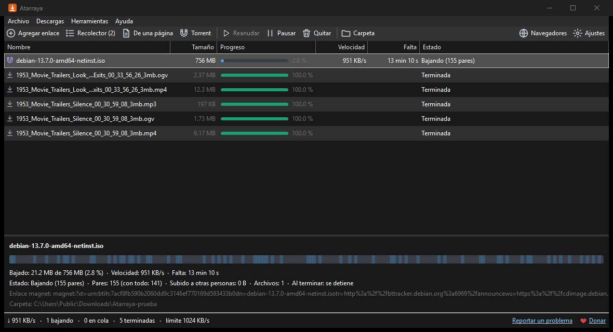

# Atarraya

**Descargas, torrents y enlaces magnet en un solo programa, gratis para Windows.** Baja cada archivo en varias partes
a la vez, se puede pausar y seguir después (aunque apagues la PC) y recibe las descargas de tu navegador. Junta
muchos enlaces en un recolector, como JDownloader, y te deja elegir qué bajar. Sin publicidad, sin virus y sin
recoger tus datos.

Hecho por [Brizna Soft](https://brizna-soft.github.io) en Honduras.



## Descargar

**[Baja la última versión](https://github.com/Brizna-Soft/atarraya/releases/latest)**: el archivo
`Atarraya-x.y.z-x64.zip`.

1. Descomprime el .zip en una carpeta, por ejemplo `Documentos\Atarraya`.
2. Abre `Atarraya.exe`. No hace falta instalar nada.

> **¿Windows dice «Windows protegió su PC»?** Sale porque el programa es nuevo y todavía no tiene firma
> digital, que cuesta dinero. Pulsa **Más información** y luego **Ejecutar de todas formas**.
>
> Si quieres comprobar que el archivo es el original, compara su huella SHA-256 con el archivo `.sha256` de la
> misma página. Los .zip los arma GitHub a partir de este mismo código.

## Qué hace

- **Varias conexiones por archivo.** Hasta 16, y 8 de fábrica. Cuando una parte termina, ayuda a la que más le
  falta, así ninguna conexión se queda sin trabajo.
- **Torrents y enlaces magnet.** Eliges qué archivos bajar, ves el progreso, la velocidad y cuántas personas lo
  comparten, pausas y sigues cuando quieras. Al terminar se detiene, salvo que marques «Seguir compartiendo».
- **Recolector de enlaces.** Pega muchos enlaces de una vez (o abre un .txt) y Atarraya te muestra el nombre y el
  tamaño de cada uno sin bajarlo, agrupados en paquetes («peli.part1.rar», «peli.part2.rar»... van juntos).
  También toma los enlaces de archivos que copies, si dejas encendido «Vigilar el portapapeles». **Nada empieza
  hasta que lo confirmas.**
- **Click'n'Load.** Sitios como filecrypt.cc pueden pasarle a Atarraya los enlaces de una carpeta, igual que a
  JDownloader, después de que tú resuelves el captcha en tu navegador. Llegan al recolector y tú decides.
- **Los archivos de una página.** Pega la dirección de una página y Atarraya te muestra los archivos que enlaza
  (videos, música, documentos, programas...) para que marques cuáles bajar. En Internet Archive usa su lista
  oficial de archivos.
- **Videos de sitios que lo permiten:** enlaces directos a un archivo de video, Internet Archive y páginas que
  ofrecen el video como archivo. **No baja videos de YouTube**: sus condiciones no lo permiten.
- **Pausar y seguir.** También después de cerrar el programa o de apagar la PC, si el servidor lo permite.
- **Cola de descargas.** Elige cuántas bajan a la vez (los torrents también cuentan); las demás esperan su turno.
- **Reintenta solo** cuando se cae el internet.
- **Límite de velocidad**, para no dejar sin internet al resto de la casa. También uno de subida para los torrents.
- **Cambiar el enlace.** Si un enlace vence, pegas uno nuevo del mismo archivo y sigue donde quedó.
- **Huella SHA-256**, para comprobar que el archivo llegó entero.
- **Cuida tu seguridad.** Marca lo bajado como «descargado de internet», igual que los navegadores, para que
  Windows y tu antivirus lo revisen antes de abrirlo.
- **Queda junto al reloj** mientras baja, y te avisa cuando termina.

## Sitios de descargas y captchas

Atarraya no se salta las esperas, los límites ni los captchas de los sitios de descargas (Rapidgator, 1fichier,
Mega y otros), ni los resuelve solo: **los captchas siempre los resuelves tú en tu navegador.** Cuando en el
recolector hay una página de esos sitios, Atarraya la abre en tu navegador para que bajes desde ahí; si tienes la
extensión de Atarraya, la descarga llega sola al programa. No abre contenedores DLC.

## Conectar con el navegador

Atarraya toma las descargas de **cualquier sitio**, igual que IDM. Las únicas que se quedan en el navegador son
las que salen de un formulario, las que arma la misma página y los videos de YouTube.

1. En Atarraya pulsa **Navegadores** → **Conectar**. Esto solo le avisa a tu navegador dónde está Atarraya,
   dentro de tu cuenta de Windows, y se puede quitar con **Quitar la conexión**.
2. Instala la extensión. Mientras llega a las tiendas, se carga a mano:
   - **Chrome, Edge o Brave:**
     1. Abre `chrome://extensions` (en Edge, `edge://extensions`).
     2. Activa el **Modo de desarrollador**.
     3. Pulsa **Cargar descomprimida** y elige la carpeta `extension\chrome` que viene dentro del .zip.
   - **Firefox:** la extensión necesita la firma de Mozilla, que todavía no tiene (la carpeta
     `extension\firefox` ya está lista para enviarla). Mientras tanto, pega los enlaces en Atarraya con
     **Agregar enlace**.
3. Listo. Lo que bajes en el navegador se pasa a Atarraya. También puedes hacer clic derecho en un enlace (o en un
   enlace magnet) y elegir **Descargar con Atarraya**.

Si Atarraya está cerrado, se abre solo junto al reloj. Si no está conectado, el navegador baja todo como siempre.

## Torrents

- Mientras un torrent baja, Atarraya también sube partes a otras personas: así funcionan los torrents. Las otras
  personas del torrent ven tu dirección de internet (IP), como en cualquier programa de torrents. Baja solo lo que
  tengas derecho a compartir.
- La primera vez que bajes un torrent, Windows puede preguntar si Atarraya puede recibir conexiones. Si pulsas
  **Cancelar**, igual baja, aunque comparte menos.
- Atarraya no abre puertos en tu router (no usa UPnP) y no anuncia en la red de tu casa lo que bajas. Cuando ningún
  torrent está bajando ni compartiendo, deja de escuchar conexiones.

## Privacidad y seguridad

- Atarraya no tiene publicidad, no manda estadísticas y no se conecta a ningún servidor de Brizna Soft. Solo
  baja lo que tú le pides.
- **Recolector:** para mostrarte el nombre y el tamaño, Atarraya le pregunta al servidor de cada enlace sin bajar
  el archivo (una consulta HEAD). No consulta solas las direcciones de tu red local. Con «Vigilar el portapapeles»
  solo toma enlaces de archivos, magnet y páginas de sitios de descargas; no guarda lo que copias y no lee lo que
  un gestor de contraseñas marca como privado. Se apaga en el mismo recolector o en **Ajustes**.
- **Click'n'Load** escucha solo en `127.0.0.1:9666`, así que nada de tu red ni de internet puede conectarse. No
  ejecuta código de las páginas, tiene topes de tamaño y de cantidad, y lo que llega espera en el recolector. Se
  apaga en **Ajustes**.
- Para que funcionen las descargas que piden haber iniciado sesión, la extensión le pasa a Atarraya, solo dentro
  de tu PC, las cookies del sitio de esa descarga. Atarraya no las guarda cuando la descarga termina y nunca las
  manda a otro sitio.
- No pide ser administrador y no cambia la configuración de Windows. «Conectar con los navegadores» solo
  escribe en tu propia cuenta (HKEY_CURRENT_USER), y «Quitar la conexión» lo borra.
- Lo que quitas de la lista con «mandar a la Papelera» va a la Papelera de Windows. Si el disco no tiene Papelera
  (pasa con algunas memorias USB), Windows te pregunta antes de borrarlo.
- Tus ajustes y tus listas están en `%LOCALAPPDATA%\Atarraya`.
- El código está aquí completo, para que cualquiera lo revise.

## ¿Algo falla?

[Reporta el problema aquí](https://github.com/Brizna-Soft/atarraya/issues/new/choose): cuéntanos qué pasó y qué
esperabas. Si puedes, adjunta el archivo `%LOCALAPPDATA%\Atarraya\registro.txt`. Solo anota el nombre de los
sitios, no las direcciones completas ni los nombres de lo que bajas.

## Apoyar

Atarraya es y seguirá siendo gratis. Si te sirve, puedes apoyar a Brizna Soft con una
[donación por PayPal](https://paypal.me/BriznaSoft) o simplemente recomendarlo.

## Compilar desde el código

Necesitas Visual Studio 2022 (o sus Build Tools) con C++ y Git. Luego:

```
powershell -ExecutionPolicy Bypass -File compilar.ps1
```

La primera vez baja vcpkg y compila wxWidgets, curl, Boost, OpenSSL y libtorrent, y tarda bastante. El programa
queda en `programa\`. Con `-SinTorrents` compila mucho más rápido, sin torrents, para probar lo demás.

## Licencia y créditos

- Código de Atarraya: licencia MIT, © 2026 Brizna Soft. Hecho con ayuda de IA.
- Bibliotecas de código abierto que usa, con su licencia:
  - [libtorrent](https://libtorrent.org): BSD-3-Clause.
  - [curl](https://curl.se): licencia de curl (del tipo MIT).
  - [wxWidgets](https://www.wxwidgets.org): wxWindows Library Licence 3.1.
  - [nlohmann/json](https://github.com/nlohmann/json): MIT.
  - [Boost](https://www.boost.org): Boost Software License 1.0.
  - [OpenSSL](https://openssl.org): Apache 2.0.
  - zlib y NanoSVG: licencia zlib.
  - libpng: PNG Reference Library License, versión 2.

  Los textos completos de esas licencias, y los de otras bibliotecas que trae la compilación, están en
  `AVISOS-DE-TERCEROS.txt`. Nombrarlas aquí no significa que sus autores respalden Atarraya.
- «JDownloader» y «Click'n'Load» se nombran solo para explicar con qué funciona Atarraya; no tiene relación con
  sus autores.
